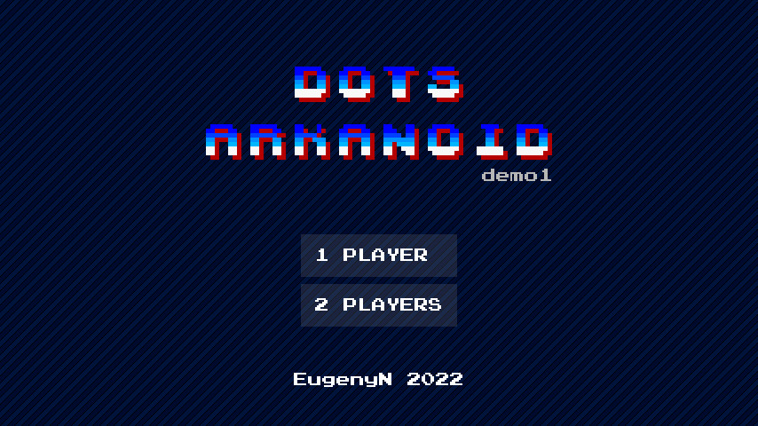
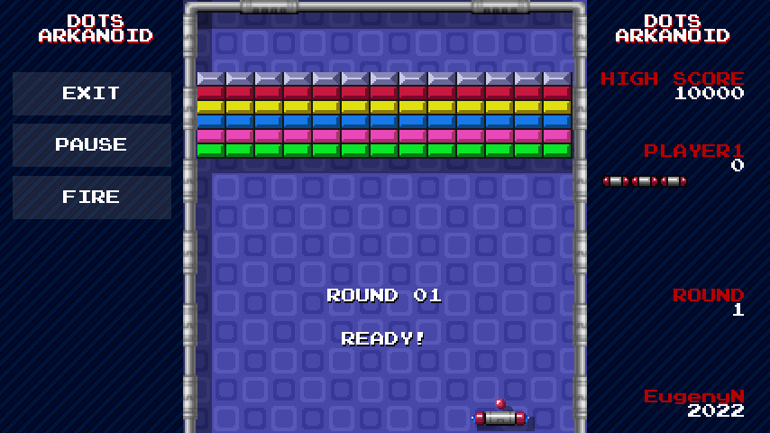
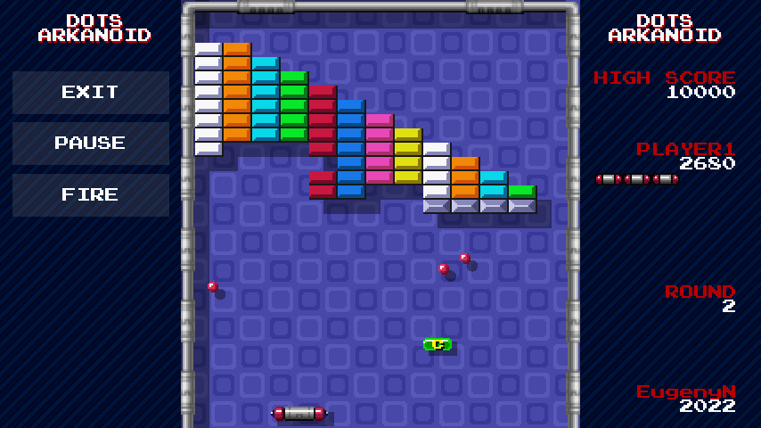
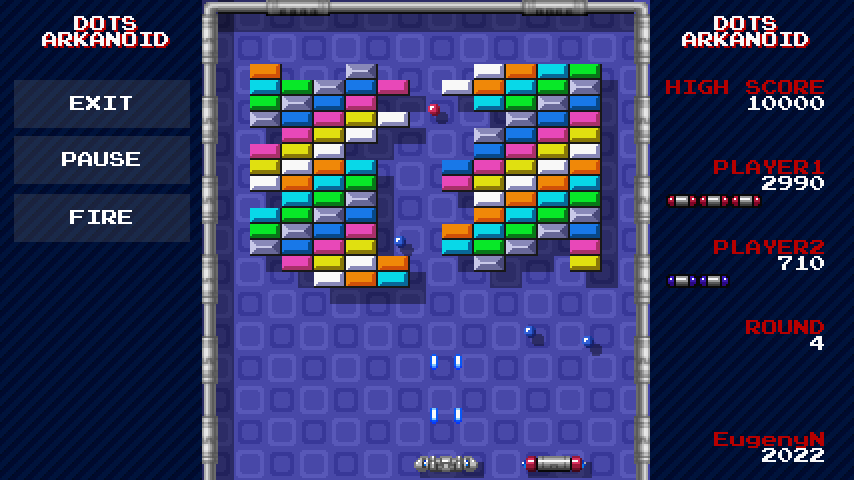

# DOTS Arkanoid

It's a clone of the classic arcade game created with Unity DOTS technologies. The game is based on the original Arkanoid gameplay. The visual style refers to the games of the 16-bit era.

The goal of this project is to get to know Unity DOTS better. DOTS (Data-Oriented Technology Stack) is a set of technologies developed by Unity for building high-performance, multithreaded code. The most important part of DOTS is the ECS component system, which allows you to write code in a data-oriented way. The DOTS Arkanoid project uses physics and rendering built on ECS. Some technical details are described below.

  &nbsp;&nbsp;
  

  &nbsp;&nbsp;
  

## Game design details

* Original game mechanics and retro look inspired by [Arkanoid](https://en.wikipedia.org/wiki/Arkanoid) arcade game and SNES Arkanoid: Doh It Again 1997 by Taito. Local coop mode inspired by Block Block (World 910910) arcade game by Capcom.
* For input you can use touch screen, keyboard (A, D, Left, Right, Space, Enter), a mouse (only player 1) and gamepads (Xbox Controller/XInput)
* Catch, Enlarge, Laser, Disruption and other power-ups are implemented; hi-score and ball speedup mechanics are implemented as well.
* 5 original stages are included, arcade version of field size 13x18 is used.
* The ball movement and bouncing physics is close to the original Arkanoid physics.
* Press Alt+Enter to switch between full screen and windowed mode (for desktop builds).

## Tech details

* I tried to avoid excessive sync points in the simulation code. Burst compilation and job scheduling is used for most jobs.
* URP + [Entities Graphics](https://docs.unity3d.com/Packages/com.unity.entities.graphics@6.6/manual/index.html) with shader for UV coord. animation.
* [DOTS Physics](https://docs.unity3d.com/Packages/com.unity.physics@latest/index.html) for triggers (ICollisionEventsJob), queries (CastCollider) and masks filtering
* You can use "F1" cheat button to spawn multiple balls.
* To enable Benchmark mode, make BenchmarkLevelsSettings active and deactivate LevelsSettings in the scene. This mode simulates 1 thousand or more balls and 20 thousand blocks.

## How to run

* Open the project in Unity, load `Assets/Scenes/Arkanoid.unity` and enter Play mode.
* To remove the "Display 1 no cameras rendering" message in Unity, uncheck "Warn if no cameras rendering" by right-clicking the three vertical dots (or the tab itself) in the top-right corner of the Game view.

## Links

* [Systems Interaction in Entity-Component-System (Events)](https://medium.com/@ben.rasooli/systems-interaction-in-entity-component-system-events-4a050153c8ac)
* [Unity DOTS forum](https://forum.unity.com/forums/data-oriented-technology-stack.147/)
* [Introduction to the DOTS for advanced Unity developers](https://unity.com/resources/introduction-to-dots-ebook)
* [Arkanoid StrategyWiki](https://strategywiki.org/wiki/Arkanoid/Gameplay)

## Third party resources

* "Press Start 2P" font, designed by CodeMan38 (OFL)
* Title logo "Wonder Boy/Sega" by [Arcade Font Writer](https://arcade.photonstorm.com/)
* Sprites from Arkanoid: Doh it Again 1997 SNES/Taito
* Sound effects from Arkanoid II NES/Taito
* Original Arkanoid gameplay by Taito Corporation

## Download

You can download DOTS Arkanoid packages for Android and Windows on the [Releases page](../../releases).

## License

Copyright (c) 2022-2026 Eugeny Novikov. The source code is under the MIT license. See [LICENSE](LICENSE).

Third-party resources listed above are not covered by the MIT license and remain under their respective owners' licenses and copyrights.
